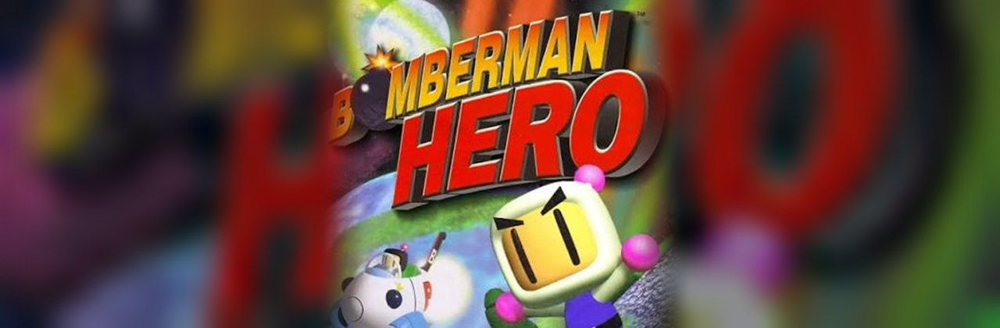

<div align="center">



# BombermanHeroNX

**Bomberman Hero on Nintendo Switch**

Unofficial Nintendo Switch port of **Bomberman Hero** (1998), built on
[Bomberman Hero: Recompiled](https://github.com/RevoSucks/BMHeroRecomp), with the
[RT64](https://github.com/rt64/rt64) renderer running on Vulkan.

[](#)
[](#)
[-AC162C?style=for-the-badge&logo=vulkan&logoColor=white)](docs/architecture.md)
[](../../releases)
[](COPYING)

</div>

---

> [!NOTE]
> First version. It starts and plays on a real Switch at 60 fps with the standard clocks, but it has only
> been played for a short while. See [Status](#status) for what has and has not been checked.

The game's own files are not included: the port runs on your copy of the game.

This is a native port, not an emulator. The game's code was translated to C once, on a PC, and runs directly on
the Switch's processor.

## What you need

- A Switch with Atmosphère and a homebrew menu (hbmenu or [sphaira](https://github.com/ITotalJustice/sphaira))
- Your own **Bomberman Hero** ROM: the North American version, in `.z64` format
- About 70 MB free on the SD card

## Installing

1. Copy the `switch` folder from the release to the root of your SD card.
2. Copy your ROM into `sd:/switch/BombermanHeroNX/` and name it `bmhero.z64`.
3. Open the homebrew menu **from a game** (hold **R** while starting any game), not from the album. The game
   needs the console's full memory, and the album only gives a small part of it.
4. Start **Bomberman Hero** and choose **Start Game**.

With another name, or a `.n64` or `.v64` file, choose **Select ROM** first: the port finds the ROM in its
folder, checks it and makes its own `bmhero.z64` from it.

Copy the ROM, don't move it: a `bmhero.z64` that is not the supported game is deleted when the port checks it.

To update, replace `BombermanHeroNX.nro`. Saves and settings stay where they are.

## Controls

| Switch | Game |
| --- | --- |
| Left stick | Move |
| A | Jump (speed up the Bomber Jet, climb with the Bomber Copter) |
| B | Throw a bomb (hold to keep throwing) |
| Y or ZR | Set a bomb at your feet (fire, in the vehicle stages) |
| ZL | Fire, in the vehicle stages |
| L / R | Turn the camera |
| X | Tilt the camera |
| Right stick | The N64's C buttons: camera, and down sets a bomb |
| + | Pause |
| − | Settings menu of the port |

The buttons follow their names: **A** on the Switch is **A** in the game, so the buttons the game talks about
are the ones in your hands. In the menus, **A** chooses and **B** goes back.

Every button can be changed in the settings menu (**−**), under **Controls**.

## Settings and files

Everything lives in `sd:/switch/BombermanHeroNX/`:

| Folder | What is in it |
| --- | --- |
| `saves/` | your save files |
| `config/` | the settings you change in the menus |
| `mods/` | texture packs and mods of Bomberman Hero: Recompiled |
| `cache/` | compiled shaders, so that later starts are faster. Safe to delete |
| `SD_LOG/` | logs |

The first start compiles the game's shaders, so the first minute or two stutters. They are kept in `cache/`
for the next time.

While the port is young, the frame rate is shown in a corner of the screen. To hide it, create an empty file
named `no-fps` in `config/`.

## Reporting a problem

Open an issue with `bmhero_log.txt` from `sd:/switch/BombermanHeroNX/SD_LOG/`, and `bmhero_crash.txt` or
`bmhero_fatal.txt` if they are there. [SD_LOG/README.md](SD_LOG/README.md) explains what each file holds.

## Status

| Area | State |
| --- | --- |
| Starts and plays on a console | Works (Switch, Horizon 23.0.1, handheld) |
| 60 fps at the standard clocks (1020 / 307 / 1331 MHz) | Works in handheld, once the shaders are compiled |
| Docked | **Not tested yet** |
| The whole game: every world, vehicle stage, boss and cutscene | **Not tested yet** |
| Saves across restarts, sleep and wake, long sessions | **Not tested yet** |
| Mods that change game code | Not supported yet; texture packs load |

The numbers, and what each remaining test needs to show, are in [docs/status.md](docs/status.md).

## Building

You need [devkitPro](https://devkitpro.org/wiki/Getting_Started), LLVM (clang and lld), Python 3, the Vulkan
driver SDK and your ROM. With those in place:

```bash
python tools/build.py all "path/to/Bomberman Hero (USA).z64"
```

The result is `SD_CARD/`, ready to copy to the card. The full list of requirements and each step are in
[docs/building.md](docs/building.md); how the port is put together is in
[docs/architecture.md](docs/architecture.md).

## Credits

- [RevoSucks](https://github.com/RevoSucks) for **Bomberman Hero: Recompiled**, which this port is built on
- [Wiseguy](https://github.com/Mr-Wiseguy) and [Darío](https://github.com/DarioSamo) for
  [N64Recomp](https://github.com/N64Recomp/N64Recomp), N64ModernRuntime, RecompFrontend and
  [RT64](https://github.com/rt64/rt64)
- The [Bomberman Hero decompilation](https://github.com/Bomberhackers/bmhero) team for the headers and symbols
- [snowboardkids2-recomp-switch](https://github.com/D35P4C1T0/snowboardkids2-recomp-switch) for the Switch
  changes to RT64, plume, the runtime and the launcher, which this port's patches are based on
- [danfromtico](https://github.com/danfromtico/mesa-switch) and the [Mesa](https://mesa3d.org) project for the
  Vulkan driver
- [devkitPro](https://devkitpro.org) for devkitA64, libnx and the Switch build of SDL2
- Hudson Soft for the game

## Disclaimer

Bomberman Hero is a trademark of its respective owners. This project is not affiliated with, endorsed or
sponsored by them. It contains no game data. The icon and the banner show the game's cover art, to identify
the game.

## License

GPL-3.0, like Bomberman Hero: Recompiled. See [COPYING](COPYING).
